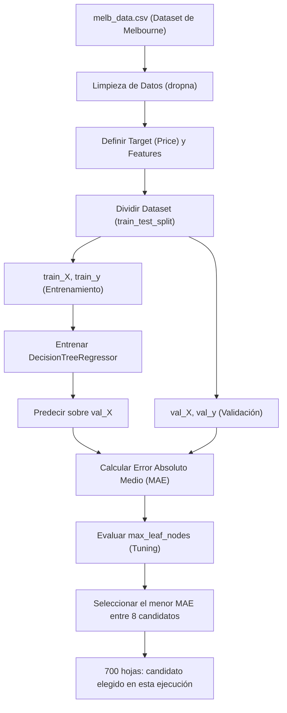

# 🤖 Aprendizaje Supervisado: Validación y Optimización de Modelos

¡Bienvenido al repositorio de **Validación y Ajuste de Modelos de Machine Learning**! Este proyecto tiene como objetivo ilustrar de forma práctica y pedagógica cómo evaluar el rendimiento de un modelo predictivo, diagnosticar problemas de **sobreajuste (overfitting)** y **subajuste (underfitting)**, y optimizar hiperparámetros utilizando un **Árbol de Decisión (`DecisionTreeRegressor`)** sobre el clásico dataset de precios de viviendas de Melbourne (`melb_data.csv`).

---

## 📋 Tabla de Contenidos
- [✨ Características Principales](#-características-principales)
- [🏗️ Estructura del Proyecto](#️-estructura-del-proyecto)
- [🔄 Flujo de Trabajo (Workflow)](#-flujo-de-trabajo-workflow)
- [⚙️ Requisitos e Instalación](#️-requisitos-e-instalación)
- [📘 Resumen de Lecciones](#-resumen-de-lecciones)
  - [Lección 1: Validación de Modelos](#lección-1-validación-de-modelos)
  - [Lección 2: Underfitting y Overfitting](#lección-2-underfitting-y-overfitting)
- [📊 Resultados Obtenidos](#-resultados-obtenidos)
- [🚀 Cómo Ejecutar](#-cómo-ejecutar)

---

## ✨ Características Principales
* **Métricas Claras:** Implementación y explicación matemática y práctica del **Error Absoluto Medio (MAE)**.
* **Validación con una partición de datos:** Comparación del error "dentro de la muestra" (*in-sample*) con el obtenido mediante una división de entrenamiento/validación de 75%/25% (`train_test_split`). No se ejecuta validación cruzada.
* **Comparación de Complejidad:** Control de la complejidad del modelo ajustando el parámetro `max_leaf_nodes` y seleccionando el menor MAE entre los candidatos evaluados.
* **Visualización de Datos:** Gráficos con `seaborn` y `matplotlib` para mostrar el MAE frente al máximo de hojas permitido.

---

## 🏗️ Estructura del Proyecto

```text
machine_learningCD/
├── data/
│   └── melb_data.csv       # Dataset de viviendas de Melbourne (Kaggle)
├── img/
│   ├── mae.png             # Gráfico conceptual de error vs complejidad
│   └── tree3.png           # Diagrama conceptual de divisiones de un árbol
├── 1_validacion_modelos.ipynb         # Lección 1: MAE y división de datos
├── 2_underfitting_y_overfitting.ipynb # Lección 2: Optimización de max_leaf_nodes
├── requirements.txt        # Dependencias del proyecto
└── README.md               # Documentación principal (este archivo)
```

---

## 🔄 Flujo de Trabajo (Workflow)

El siguiente diagrama de flujo ilustra el ciclo completo implementado en los cuadernos para entrenar, validar y optimizar el modelo de regresión:



---

## ⚙️ Requisitos e Instalación

Este proyecto requiere **Python 3.10+** y los paquetes listados en `requirements.txt`.

### 1. Clonar o acceder al directorio del proyecto:
```bash
cd machine_learningCD
```

### 2. Crear y activar un entorno virtual:
```bash
# En macOS/Linux
python -m venv .venv
source .venv/bin/activate
```

### 3. Instalar las dependencias necesarias:
```bash
pip install -r requirements.txt
```

> [!NOTE]
> Las dependencias principales instaladas son:
> * `scikit-learn` - Para la creación, división y evaluación del modelo.
> * `pandas` - Para manipulación y limpieza de datos estructurados.
> * `numpy` - Para operaciones numéricas eficientes.
> * `seaborn` & `matplotlib` - Para visualización de métricas y tendencias.
> * `jupyterlab` - Para la visualización y ejecución interactiva de cuadernos.

---

## 📘 Resumen de Lecciones

### Lección 1: Validación de Modelos
Esta sección aborda la pregunta fundamental: **¿Qué tan preciso es nuestro modelo con datos nuevos?**

* **Métrica MAE:** Se introduce el Error Absoluto Medio, definido formalmente como:
  $$\text{MAE} = \frac{1}{n} \sum_{i=1}^{n} |y_i - \hat{y}_i|$$
  *En términos sencillos: "En promedio, nuestras predicciones difieren del precio real por X, en las mismas unidades de la columna `Price`".*
* **La trampa del error "In-Sample":** El árbol evaluado sobre todos los datos con los que se entrenó obtiene un MAE de **434.72**. Al entrenar otro árbol solo con el subconjunto de entrenamiento y evaluar en validación, el MAE es **265,345.35**. El primer resultado no mide la capacidad de predecir datos nuevos.
* **Solución:** Se implementa `train_test_split` con `random_state=0` para separar **75% de entrenamiento y 25% de validación**. La evaluación se realiza sobre registros que ese árbol no utilizó para entrenar.

### Lección 2: Underfitting y Overfitting
En esta lección exploramos cómo controlar la complejidad del árbol de decisión para encontrar el equilibrio perfecto.

* **Sobreajuste (Overfitting):** Ocurre cuando el árbol es demasiado profundo. El modelo memoriza el ruido y las peculiaridades del set de entrenamiento, incrementando el error en los datos de validación.
* **Subajuste (Underfitting):** Ocurre cuando el árbol es demasiado superficial (pocas hojas). El modelo no logra capturar los patrones generales y tiene un rendimiento deficiente tanto en entrenamiento como en validación.
* **Ajuste de `max_leaf_nodes`:** Se crea una función iterativa `calcular_mae` para probar los máximos de hojas `[5, 50, 500, 600, 700, 800, 1000, 5000]`, analizando la curva de error resultante. Este parámetro limita las hojas, no el número total de nodos del árbol.

---

## 📊 Resultados Obtenidos

Al realizar el análisis de validación y optimización de hiperparámetros sobre la base de datos de viviendas de Melbourne con las siguientes columnas predictoras (*Features*):
* `Rooms` (Habitaciones)
* `Bathroom` (Baños)
* `Landsize` (Tamaño del terreno)
* `BuildingArea` (Área de construcción)
* `YearBuilt` (Año de construcción)
* `Lattitude` (Latitud)
* `Longtitude` (Longitud)

Después de `dropna(axis=0)`, se conservan **6,196 viviendas**: **4,647** para entrenamiento y **1,549** para validación. Se utiliza `random_state=0` tanto en la división como en los árboles.

Los siguientes resultados corresponden a **scikit-learn 1.9.1**. Las semillas fijadas permiten repetir el experimento con los mismos datos y entorno; otras versiones pueden producir resultados distintos. Todos los MAE se expresan en las mismas unidades que `Price` y están redondeados a dos decimales.

| Máximo de hojas (`max_leaf_nodes`) | MAE de validación | Observación |
|:---------------------------------:|-----------------:|:------------|
| 5 | 347,380.34 | Subajuste: modelo muy simple |
| 50 | 258,171.21 | Mejora respecto a 5 hojas |
| 500 | 243,495.96 | Cercano al mínimo evaluado |
| 600 | 243,951.09 | Mayor error que con 500 hojas |
| **700** | **242,954.69** | **Menor MAE entre los candidatos** |
| 800 | 244,042.74 | Mayor error que con 700 hojas |
| 1000 | 247,378.75 | Aumenta el error de validación |
| 5000 | 255,575.13 | Compatible con sobreajuste |

> [!IMPORTANT]
> **Conclusión:** Un máximo de **700 hojas** obtiene el menor MAE de validación **entre los ocho candidatos evaluados**, con esta partición de datos y esta versión de scikit-learn. Este resultado no establece un óptimo global.

La misma partición de validación se utiliza para elegir el máximo de hojas. Por ello, el MAE seleccionado sirve para comparar candidatos, pero no es una evaluación final independiente del proceso de ajuste. No se ejecutó validación cruzada ni se reservó otro conjunto de prueba final.

---

## 🚀 Cómo Ejecutar

Para abrir y experimentar con los cuadernos en tu computadora local:

1. Inicia JupyterLab en tu terminal:
   ```bash
   jupyter lab
   ```
2. En la interfaz web de Jupyter, abre el archivo `1_validacion_modelos.ipynb` y ejecuta las celdas secuencialmente para observar el impacto de la separación de datos de validación.
3. Posteriormente, abre `2_underfitting_y_overfitting.ipynb` para comparar los candidatos mediante la curva de MAE de validación en función del máximo de hojas.

---
*Desarrollado como recurso de aprendizaje interactivo para fundamentos de Ciencia de Datos y Machine Learning.*
